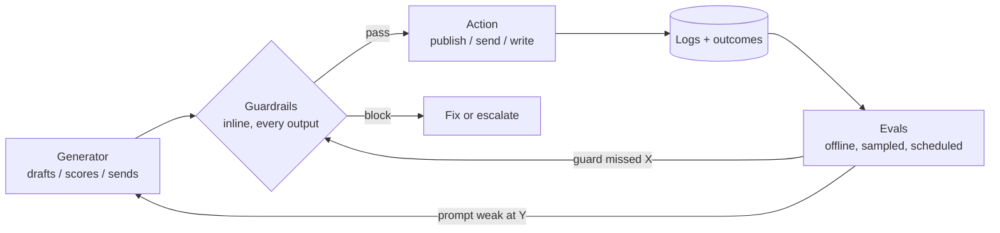

# 00 · The mental model

## Two systems, one loop



| | Guardrails | Evals |
|---|---|---|
| **Question** | Is this output allowed to go out? | How good is the system, and is it getting better or worse? |
| **When** | Inline, before the action | Offline: on change, nightly, per checkpoint |
| **Coverage** | 100% of outputs | Golden sets + samples of production |
| **Output** | pass / block / escalate | Scores, catch rates, trends |
| **Failure cost** | A bad output ships | You don't know your guards are leaking |

**If-then:** if you only build guardrails, you can't tell whether they catch anything. If you only build evals, you find out about the bad email after 400 people got it.

## Three eval levels

```
L3  OUTCOME     Did the business move?              reply rate, meetings, ₹ bridge, approver edit rate
     ▲          (slow, noisy, the only one clients care about)
L2  BEHAVIOUR   Did the system do the right thing?  on-thesis %, personalisation factuality, routing accuracy
     ▲          (LLM judge + rubric + reference, calibrated against human labels)
L1  COMPONENT   Did each piece work?                regex hits, schema valid, numbers traceable, dedupe works
                (deterministic, runs in CI, seconds)
```

**Rule:** a failure at L3 is diagnosed by going *down* the stack. Reply rate dropped → check L2 (are personalisation facts still accurate?) → check L1 (is the enrichment API returning nulls?). If you only measure L3, every problem looks like "the market changed."

## Three enforcement types

| Type | Use when | Example | Cost |
|---|---|---|---|
| **Deterministic** | The rule can be written as code | "Every ₹ figure has a stamp within the same line" | ~0 |
| **Model-based** | Needs judgment, *and* you have a reference | "Does this draft pass the swap test against these 3 competitors?" | 1 extra call |
| **Human** | Irreversible, external, or reputational | Founder approves a post; Akul approves a bulk send | Minutes of a person |

**Order them cheapest first.** Deterministic guards fail fast, so the judge never wastes tokens on a draft that has an unsourced number in line one. The human only sees what passed both.

## What "good" looks like for a guard

A guard has two error types, and they cost different amounts:

- **Miss (false negative):** a bad output ships. For R3 actions (bulk send, publish) this is the expensive one, so tune for **recall ≥ 0.95** on must-block cases.
- **False alarm (false positive):** a good output gets blocked. Annoying, and teams start bypassing the guard. Track it. If precision drops under ~0.8, people will route around the guard.

`evals/run_evals.py` reports both for every guard.
