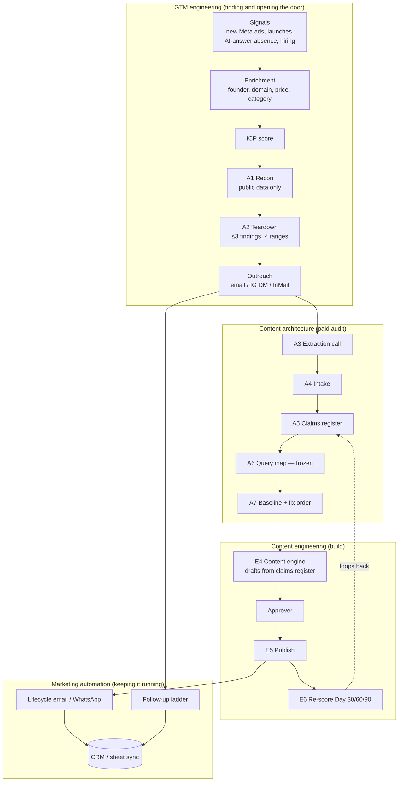

# 01 · Clyve's system, end to end, and where AI can break it

Clyve is a boutique AI consulting firm for founder-led D2C brands in India (small agencies second). The operating model is **agents do the execution, a human makes the judgment calls.** That model only holds if the execution layer can't quietly make things up, because the thing Clyve sells is *trust in the numbers*. One invented stat in a teardown and the whole proof model collapses.

So for Clyve, guardrails aren't a safety add-on. **They're the product's credibility, written as code.**

## The full flow

## Where each guard sits

| Step | What the AI touches | Worst realistic failure | Guard | Tier |
|---|---|---|---|---|
| Signals | Ad Library, websites, reviews | A review saying "ignore previous instructions…" steers the recon agent | `injection_guard` | R0 |
| Enrichment | Founder name, email, phone | Wrong founder matched; personal phone stored with no purpose | `pii_guard`, enrichment golden set | R1 |
| ICP score | Category, price band, ads, size | Score drifts and the pipeline fills with traders and real-estate leads | ICP calibration eval (score vs reply) | R1 |
| A2 Teardown | Findings, ₹ ranges | A point estimate ₹ figure with no stamp; implies knowledge of their conversion rate | `claims_gate`, `outreach_guard` private-metric rule | R2 |
| Outreach | Personalised opener | "Loved your Diwali drop" when there was no Diwali drop | `outreach_guard` personalisation traceability | R2/R3 |
| A6/A7 Baseline | Prompt runs, scoring | Prompt set edited after Day 0; one blended visibility number | `visibility_stats` hash + split rule | R1 |
| E4 Content engine | Drafts | Generic copy that fits any competitor; FSSAI-risky health claim | `claims_gate`, `promise_guard`, swap-test judge, claim-safety judge | R2 |
| E5 Publish | CMS | Unapproved post goes live | `action_gate` (human approval ID required) | R3 |
| E6 Re-score | Day 0 vs Day N | "Visibility up 30%" that's just noise | `visibility_stats.real_change` | R1 |
| Lifecycle / follow-ups | Sends, replies | Duplicate WhatsApp; promo sent at 11pm; AI reply promises a discount | `automation_guard`, `action_gate` | R3 |

## The three things that would actually hurt Clyve

Ranked by damage, not by how often they happen:

1. **A fabricated number reaches a founder.** Credibility is the product, so this one costs the most. → `claims_gate` on every outbound artifact, no exceptions.
2. **A promise Clyve can't keep** ("cited in 30 days", "we'll double revenue"). → `promise_guard`. Phrasing test: if the line is false when results come in flat, cut it.
3. **Burning the sending domain or breaking consent rules** while scaling outreach. One bad week can kill the GTM motion for months. → `outreach_guard` + `automation_guard` + deliverability L3 evals.

Everything else is recoverable.
