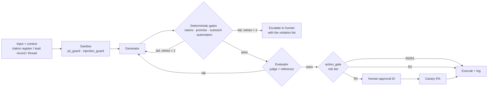

# 02 · Architecture

Designed with the agent-architecture method in [the references](#references): pick the lowest tier that works, separate generator from evaluator, make gates deterministic, and treat context as a budget.

## 1. Architectural tier & justification

```
Is the task decomposable into independent parallel subtasks?
├─ Content drafting, outreach writing, lifecycle replies
│    → NO, each step depends on the claims register / the lead / the thread
│    → L2: one agent in a loop + deterministic gates + independent evaluator
└─ Visibility runs (same prompt set × 3 engines × 3 runs) and batch recon across 50 brands
     → YES, fully parallel, tool-heavy
     → Parallel tool calls under ONE orchestrator, with an aggregation check.
        Never independent agents writing straight to the report: errors compound with no checker.
```

**Default for every Clyve lane: L2.** Multi-agent systems on sequential work degrade results and multiply cost. The only fan-out is measurement, and that fan-out is tool calls, not "agents with personalities."

## 2. Workflow topology



**Self-healing routes:** if an enrichment provider fails, route to the next provider in cost order. If all fail, mark the lead `needs_manual` and keep going. **Never fill the field with a guess.** No route is silent: every reroute or skip is logged.

## 3. Generator–evaluator contract

| | Generator | Evaluator |
|---|---|---|
| Sees | Task + claims register + voice rules | The output **+ the same ground truth** + rubric |
| Told | "Use only facts from the register" | "Assume this output is broken. Find the line that would embarrass Clyve." |
| Does | Writes | **Executes** checks: looks up every number, matches every personalisation fact to a signal, runs the swap test against named competitors |
| Can't | Grade itself | Rewrite. It returns violations, not new copy |

Same-model judges are fine **when they have ground truth to check against**. Without a reference they drift toward agreeing with the draft.

**Stop conditions (machine-checkable):** all gates pass, or 2 regeneration attempts used up (then escalate), or the token budget for the run is gone (then stop and report). The human kill switch is an env var / file the `action_gate` checks before every R2+ action.

## 4. Context & token plan

- **Constraints first, task last.** Non-negotiable rules (no bare numbers, no promises, register-only facts) sit at the top of the system prompt; the volatile task sits at the bottom. That's also the layout that caches well.
- **Count the rules.** Instruction-following degrades as the rule count grows. Keep always-on rules under ~15 per prompt; move category rules (FSSAI, ASCI, WhatsApp templates) to on-demand files loaded only when `regulated: true`.
- **One level of disclosure.** Root prompt → on-demand rule files. No nested routers.
- **Filter before injecting.** The generator gets the 5–10 relevant claims, not the whole register. Context rot is real at every length.
- **Playbook, not summaries.** Lessons from evaluator failures go into `playbook.md` as small additions ("Drafts kept rounding 4.6★ to 5★ → added rule"), never as a rewritten summary that loses the specifics.
- **Fresh prompt per job.** Long chat threads drift. Consolidate the requirements into one fully specified prompt before any R2+ generation.

## 5. Failure-mode audit

See [07-failure-modes.md](07-failure-modes.md). The top three for marketing systems: **disobeying the task spec** (invented facts), **incorrect verification** (the judge has no reference), **step repetition** (duplicate sends).

## 6. Implementation artifact

The `guardrails/` package is the deterministic layer. `evals/judges/` holds the evaluator prompts. `guardrails/action_gate.py` is the tier enforcer that sits in front of every external action, whether that's n8n, a Python script or a Claude Code loop.

## References

- Cemri et al. (2025), *Why Do Multi-Agent LLM Systems Fail?* (MAST taxonomy)
- Kim et al. (2025), *Towards a Science of Scaling Agent Systems*
- Hong et al. (2025), *Context Rot*; Jaroslawicz et al. (2025), *How Many Instructions Can LLMs Follow at Once?*
- Zhang et al. (2025), *Agentic Context Engineering (ACE)*
- Roytburg et al. (2026), *Are LLM Evaluators Really Narcissists?*
- Bholani (2026), *Graph-Based Self-Healing Tool Routing*
