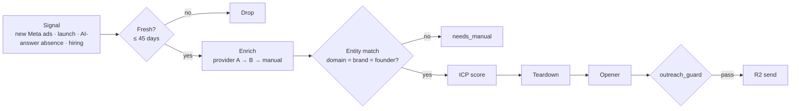

# Lane · GTM engineering

**What the AI does:** signal-based lead gen. Detects buying signals, enriches the account and the founder, scores ICP fit, builds a public-data teardown, writes the personalised opener, and runs the follow-up ladder.

## Failure → guard → eval

| Failure | Guard | Eval |
|---|---|---|
| **Made-up personalisation** ("loved your Diwali drop") | `outreach_guard`: every fact in `claims_about_lead` must match a stored signal with a source URL, within freshness | Personalisation golden set; recall 1.0 on invented facts |
| Stale signal (ad from 5 months ago called "your new campaign") | Freshness window in policy | Same |
| Wrong person enriched (namesake founder, old company) | Entity-match check: email domain = brand domain, LinkedIn company = brand | **Enrichment golden set**: 50 hand-verified leads, field-level precision. Target ≥ 0.95 on email + name |
| Implying private data ("your conversion rate is 1.2%") before intake | `outreach_guard` private-metric patterns blocked unless stage ≥ audit | Seeded cases |
| Teardown ₹ shown as a point estimate | `claims_gate` range rule for `ASSUMED · ±1` | Seeded cases |
| Suppressed / opted-out contact emailed again | Suppression lookup, every send | — |
| No unsubscribe / opt-out line | `outreach_guard` | — |
| Domain burn | Per-inbox daily cap, warm-up state, bounce + complaint stop thresholds | L3: bounce < 2%, spam complaints well under 0.3% (stop at 0.1%) |
| ICP drift (traders, real estate, directory buyers fill the list) | Hard exclude list for categories in policy | **ICP calibration**: score decile vs positive-reply rate. If the top decile doesn't beat the bottom, the score is decoration |
| Scraped page contains instructions | `injection_guard` wraps + flags | Adversarial rows in recon set |

## Evals that matter most here

1. **Personalisation factuality** (L2). The cheapest way to lose a founder's trust is a wrong fact about their own brand in line one.
2. **Enrichment precision** (L1/L2). Measure it per provider, so the fallback order is chosen on data, not on price.
3. **ICP calibration** (L3). Bucket last quarter's leads by score; plot positive-reply rate per bucket. A monotonic line means the score works.
4. **Reply classification accuracy** (L2). If an AI tags replies (interested / not now / wrong person / unsubscribe), check it on 50 labelled replies. **"Unsubscribe" must have recall 1.0.** A missed opt-out is a compliance failure, not a quality issue.

## If-then

- If a lead has no fresh, sourced signal → it doesn't get a personalised opener. Use the teardown finding instead; that's sourced by design.
- If enrichment confidence < threshold → `needs_manual`, never a best guess.
- If bounce rate on any inbox crosses the policy stop → `action_gate` pauses that inbox automatically.

## Added in 0.1.1

| Failure | Guard |
|---|---|
| An enrichment or research agent writes a fact with no source or date, or an old one, and the next email quotes it | `enrichment_guard.check_write(record, policy, today)` |
| It stores a forbidden field or protected attribute (`founder_religion`, `pan_number`, …), whatever it's called | `enrichment_guard`: blocked by whole-word match on the field name |
| It stores a personal Gmail or mobile number under legitimate interest | `enrichment_guard`: needs consent |
| It drops personal data into free-text notes | `enrichment_guard` (runs `pii_guard` on free text) |
| A sender account gets restricted for sending too many InMails, LinkedIn or Instagram DMs | `outreach_guard`: `daily_cap_per_channel`, with `context["sent_today_by_channel"]` |

In this lane, a workflow with `crm_update` must wire in `enrichment_guard` or the gate blocks it.
